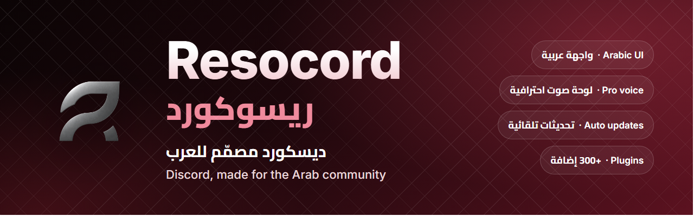
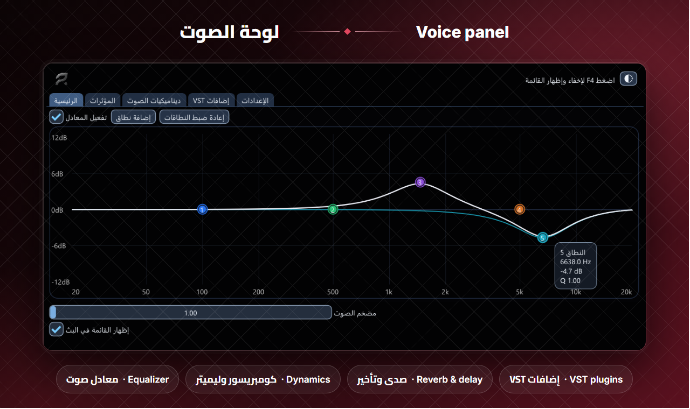
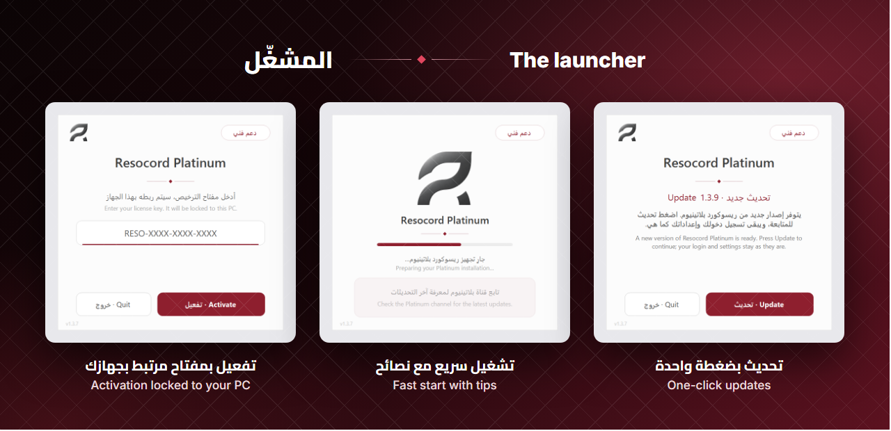

  

  
  
  

<h3 align="center" dir="rtl">ديسكورد مخصّص للعرب، بمزايا لن تجدها في أي مكان آخر</h3>

A custom Discord client made for the Arab community, packed with features you won't find anywhere else.

 

## ✨ المزايا

| | |
|:--|:--|
| 🌍 **واجهة عربية كاملة** ديسكورد بالكامل بالعربية، وصفحات إعدادات بالعربية والإنجليزية. | 🎙️ **لوحة صوت احترافية** معادل صوت برسم مباشر، كومبريسور وليميتر وبوابة ضوضاء، صدى وتأخير وستيريو، وإضافات VST. |
| 🔄 **تحديثات تلقائية** عند صدور إصدار جديد يحدّث المشغّل نفسه بضغطة واحدة، ويبقى تسجيل دخولك وإعداداتك. | 🚫 **بدون إعلانات** إخفاء إعلانات النيترو والمتجر والمهام وتعزيز السيرفرات. |
| 🖥️ **مشاركة شاشة أكثر ثباتًا** إصلاح التحميل اللانهائي والأعطال عند مشاركة الشاشة. | 🔒 **خصوصية أكثر** قفل برمز سري، تشفير الرسائل، وإخفاء سريع للشاشة. |
| 🌐 **ترجمة تلقائية** ترجمة الرسائل تلقائيًا أثناء المحادثة. | 🧩 **أكثر من 300 إضافة** كل إضافات Equicord، ومعها إضافات ريسوكورد الخاصة. |

 

  

## 💎 ريسوكورد بلاتينيوم

النسخة الكاملة من ريسوكورد، مع لوحة الصوت الاحترافية (اضغط **F4** لإظهارها)، وصفحة **Reso Cord** داخل إعدادات ديسكورد بالعربية والإنجليزية، وتحديثات تلقائية بضغطة واحدة. التفعيل بمفتاح ترخيص مرتبط بجهازك.

للحصول على بلاتينيوم أو للدعم الفني، انضم إلى [سيرفر ريسو](https://discord.gg/reso).

  

<b>English</b>

 

**Resocord** is a custom Discord client made for the Arab community.

- 🌍 **Full Arabic interface**: Discord itself in Arabic, with settings pages in Arabic and English.
- 🎙️ **Pro voice panel**: equalizer with a live graph, compressor, limiter, noise gate, reverb, delay, stereo and VST plugins.
- 🔄 **Automatic updates**: the launcher updates itself in one click; your login and settings stay.
- 🚫 **No ads**: Nitro, Shop, Quest and Server Boost upsells are hidden.
- 🖥️ **Stable screen share**: fixes endless loading and crashes when sharing your screen.
- 🔒 **More privacy**: passcode lock, message encryption and a quick screen blur.
- 🌐 **Auto translate** messages as you chat.
- 🧩 **300+ plugins**: every Equicord plugin, plus Resocord's own.

**Resocord Platinum** is the full edition: the voice panel (press **F4**), the **Reso Cord** page inside Discord's settings, and one-click updates, activated with a license key locked to your PC.

Get Platinum or support in the [Reso server](https://discord.gg/reso).

 

Resocord is built on <a href="https://github.com/Equicord/Equicord">Equicord</a> and <a href="https://github.com/Vendicated/Vencord">Vencord</a>, and is licensed under GPL-3.0.

